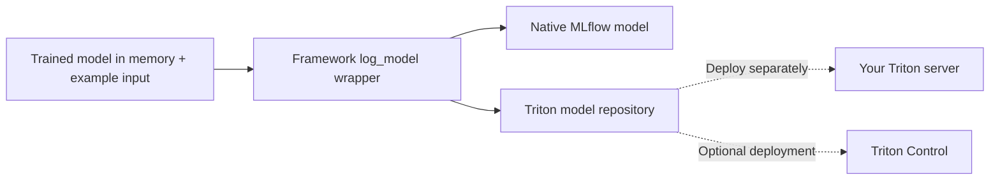

# MLflow → Triton

**Log trained models to MLflow with portable Triton serving files.**

[](https://github.com/ai-lab-tech/mlflow-plugin/actions/workflows/mlflow-plugin-ci.yml)
[](LICENSE)
[](packages/mlflow-triton/pyproject.toml)

[API reference](packages/mlflow-triton/README.md#log-api-reference) ·
[Examples](examples/README.md) ·
[Deployment integration](packages/mlflow-triton-control/README.md) ·
[Contributing](CONTRIBUTING.md)

**For data scientists: prepare models for Triton demos and hand them off to ML engineers for production optimization.**

Log a fitted sklearn pipeline, a PyTorch module or a Hugging Face pipeline with
an example prediction input. The core package preserves the native MLflow model and adds
a complete Triton Python-backend model directory: configuration, serving code,
model assets and a local validation report.

Designed for demos and proofs of concept. It does not retrain models or use an
LLM to generate adapters. Before production use, ML engineers must review,
validate and optimize the serving implementation.



## Choose your package

| Package | Use it for | Requires Triton Control? |
| --- | --- | --- |
| **[mlflow-triton](packages/mlflow-triton/README.md)** | Log wrappers, signatures, CPU/GPU configuration and complete Triton artifacts | No |
| **[mlflow-triton-control](packages/mlflow-triton-control/README.md)** | Deployment through the [Triton Control](https://github.com/ai-lab-tech/triton-control) API | Yes |

The integration installs the matching core package and registers the MLflow
`triton-control` deployment target. No activation flag is needed. Existing
`mlflow_triton_control` logging imports remain compatible with the integration installed.

## Quick start

Requires Python 3.10+. To install the latest published core release from PyPI:

```bash
python -m venv .venv
source .venv/bin/activate
python -m pip install --upgrade mlflow-triton
# Install the framework/version required by your model separately.
```

With your already-fitted pipeline and a representative input DataFrame:

```python
from mlflow_triton import sklearn

info = sklearn.log_model(
    fitted_pipeline,
    name="classifier",
    input_example=example_dataframe,
)
print(info.model_uri)
```

The model and generated Triton serving files are now stored in MLflow at
`info.model_uri`. No additional save or load call is needed.

Configure MLflow's tracking URI and experiment before logging to choose where
artifacts are stored. `input_example` is a required prediction input, such as a
DataFrame; it is not a Triton HTTP request. See the
[argument tables](packages/mlflow-triton/README.md#log-api-reference) for signatures,
custom architectures, tokenizers, dependencies and CPU/GPU serving configuration.

To install or upgrade the optional Triton Control deployment integration:

```bash
python -m pip install --upgrade mlflow-triton-control
mlflow deployments help -t triton-control
```

The integration installs its matching core version automatically, so this command
also works without installing the core separately. Check installed dependencies:

```bash
python -m pip check
```

These commands install published releases, which may differ from the current
checkout. Before the first release or to use unreleased changes, install from
source instead; the large example weights are not needed:

```bash
GIT_LFS_SKIP_SMUDGE=1 git clone https://github.com/ai-lab-tech/mlflow-plugin.git
cd mlflow-plugin
python -m pip install ./packages/mlflow-triton
# Optional deployment integration, using the matching local core:
python -m pip install ./packages/mlflow-triton ./packages/mlflow-triton-control
```

## What gets saved

```text
MLflow model artifact/
├── MLmodel                      # Native flavors + Triton flavor
├── ...                          # Native model assets
└── model_repository/classifier/
    ├── config.pbtxt
    ├── requirements.txt
    ├── request.json             # Or request.bin + request.headers for binary inputs
    ├── validation.json
    └── 1/
        ├── model.py
        └── artifact/            # Self-contained native MLflow model
```

The generated runtime loads the packaged artifact locally. By default, logging
validates predictions using the supplied model and checks tensor mappings without
reloading weights. Set `validate_saved_model=True` to instead validate a CPU reload
of the saved artifact, requiring memory for another copy. Logging does **not**
launch Triton.
Triton execution is a separate validation step. Dependencies must be installed
in a compatible serving environment.

## Retrieve serving files locally (optional)

If you need the generated files for inspection or deployment, retrieve them from
MLflow:

```python
from mlflow_triton import triton

model_directory = triton.load_model(info.model_uri)
print(model_directory / "config.pbtxt")
```

Despite its name, `triton.load_model()` returns a local directory path, downloading
artifacts as needed. It does not load model weights into memory or load the model
into a running Triton server. The directory contains one model; deployment is a
separate step using your serving tooling.

## Send an example request

From the generated model directory, with the model loaded in Triton, send the
single generated `request.json`. Replace `classifier` with your Triton model name:

```bash
curl --fail-with-body --show-error -X POST \
  http://localhost:8000/v2/models/classifier/infer \
  -H 'Content-Type: application/json' \
  --data-binary @request.json
```

For non-finite numbers or binary byte inputs, logging generates `request.bin` and
`request.headers` instead. Send these without editing the body or header length:

```bash
curl --fail-with-body --show-error -X POST \
  http://localhost:8000/v2/models/classifier/infer \
  -H @request.headers --data-binary @request.bin \
  --dump-header response.headers --output response.bin
```

The binary response is saved with its HTTP headers. Regenerate the example if the
model schema or example inputs change. Neither logging nor generating these files
sends requests automatically.

## Framework support

| Framework | Model supplied by the caller | Target device |
| --- | --- | --- |
| sklearn | Fitted estimator or preprocessing Pipeline | CPU |
| PyTorch | Instantiated module, trained weights, `.eval()`, required custom code | CPU / GPU |
| Hugging Face | Supported pipeline or model/tokenizer/processor components | CPU / GPU |

Support follows MLflow's saved Python prediction interface. External preprocessing,
missing architecture code, unsupported task outputs and streaming generation need
additional integration. GPU configuration is not proof of GPU validation. Read the
[API limitations](packages/mlflow-triton/README.md) before choosing a serving path.

## Run the examples

The shared catalog tracks **13 saved-model cases**. Five cases using synthetic
training data are included here; eight cases pending license review live in the
private test-data repository. See [data setup](examples/data/README.md) for preparing
a combined local dataset. To run the public fixtures, retrieve their weights and
select a writable output location:

```bash
git lfs install --local
git lfs pull
python examples/run_real_models.py --device cpu --output-root /path/to/test-output
```

The runner requires Docker and validates real Triton responses against native
predictions. See [examples](examples/README.md) for GPU runs, storage requirements
and result interpretation, and [dataset provenance](examples/data/README.md) for
artifact origins. The example data are excluded from both Python distributions.

## Project documentation

| Topic | Guide |
| --- | --- |
| Logging API and arguments | [Core package](packages/mlflow-triton/README.md) |
| Optional deployment | [Triton Control integration](packages/mlflow-triton-control/README.md) |
| Local development and tests | [Contributing](CONTRIBUTING.md) |
| Shared versions and publishing | [Releasing](RELEASING.md) |
| Reporting vulnerabilities | [Security policy](SECURITY.md) |
| Source and model attribution | [Third-party notices](THIRD_PARTY_NOTICES.md) |

## License and attribution

Original project code is licensed under [Apache-2.0](LICENSE). Included upstream
sources, model assets and dependencies retain their own terms; see
[third-party notices](THIRD_PARTY_NOTICES.md) and the documented outstanding
artifact-license review. Project names are used to identify integrations; this
project does not imply endorsement by MLflow, NVIDIA, PyTorch or Hugging Face.
