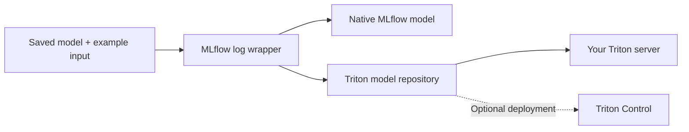

# MLflow → Triton

**Turn saved models into portable Triton serving artifacts.**

[](https://github.com/ai-lab-tech/mlflow-plugin/actions/workflows/mlflow-plugin-ci.yml)
[](LICENSE)
[](packages/mlflow-triton/pyproject.toml)

[API reference](packages/mlflow-triton/README.md#log-api-reference) ·
[Examples](examples/README.md) ·
[Deployment integration](packages/mlflow-triton-control/README.md) ·
[Contributing](CONTRIBUTING.md)

Log a fitted sklearn pipeline, a PyTorch module or a Hugging Face pipeline with
an example request. The core package preserves the native MLflow model and adds
a complete Triton Python-backend model directory: configuration, serving code,
model assets and a local validation report.

Built for Data Scientists presenting models and handing a serving baseline to
ML Engineers. It does not retrain models or use an LLM to generate adapters.
Production optimization and deployment operations remain separate tasks.



## Choose your package

| Package | Use it for | Requires Triton Control? |
| --- | --- | --- |
| **[mlflow-triton](packages/mlflow-triton/README.md)** | Log wrappers, signatures, CPU/GPU configuration and complete Triton artifacts | No |
| **[mlflow-triton-control](packages/mlflow-triton-control/README.md)** | Deployment through the [Triton Control](https://github.com/ai-lab-tech/triton-control) API | Yes |

The integration installs the matching core package and registers the MLflow
`triton-control` deployment target. No activation flag is needed. Existing
`mlflow_triton_control` logging imports remain compatible with the integration installed.

## Quick start

Install from a checkout; this does not require downloading the large example weights:

```bash
GIT_LFS_SKIP_SMUDGE=1 git clone https://github.com/ai-lab-tech/mlflow-plugin.git
cd mlflow-plugin
python -m venv .venv
source .venv/bin/activate
pip install ./packages/mlflow-triton
# Install the framework/version required by your saved model separately.
```

With your already-fitted pipeline and a representative input DataFrame:

```python
from mlflow_triton import sklearn, triton

info = sklearn.log_model(
    fitted_pipeline,
    name="classifier",
    input_example=example_dataframe,
)
repository = triton.load_model(info.model_uri)
print(repository)  # Local model directory ready for your serving workflow
```

Use MLflow's normal tracking configuration to choose where artifacts are stored.
`input_example` is required. See the [argument tables](packages/mlflow-triton/README.md#log-api-reference)
for signatures, custom architectures, tokenizers, dependencies and GPU selection.

To add the optional deployment client from the same checkout:

```bash
pip install ./packages/mlflow-triton-control
mlflow deployments help -t triton-control
```

Package-index installation instructions in the package READMEs apply to published
releases; this README does not imply that version `0.4.0` is already on PyPI.

## What gets saved

```text
MLflow model artifact/
├── MLmodel                      # Native flavors + Triton flavor
├── ...                          # Native model assets
└── model_repository/classifier/
    ├── config.pbtxt
    ├── requirements.txt
    ├── validation.json
    └── 1/
        ├── model.py
        ├── contract.json
        └── artifact/            # Self-contained native MLflow model
```

The generated runtime loads the packaged artifact locally. Logging validates
saved-model prediction and tensor mappings; it does **not** launch Triton.
Triton execution is a separate validation step. Dependencies must be installed
in a compatible serving environment.

## Framework support

| Framework | Model supplied by the caller | Target device |
| --- | --- | --- |
| sklearn | Fitted estimator or preprocessing Pipeline | CPU |
| PyTorch | Instantiated module, trained weights, `.eval()`, required custom code | CPU / GPU |
| Hugging Face | Supported pipeline or model/tokenizer/processor components | CPU / GPU |

Support follows MLflow's saved Python prediction interface. External preprocessing,
missing architecture code, unsupported task outputs and streaming generation need
additional integration. GPU configuration is not proof of GPU validation. Read the
[API limitations](packages/mlflow-triton/README.md) before choosing a serving path.

## Run the examples

The repository includes **13 saved-model cases**: four sklearn, four PyTorch and
five Hugging Face, including custom architectures. Retrieve weights with Git LFS
only when needed, then select a writable output location:

```bash
git lfs install --local
git lfs pull
python examples/run_real_models.py --device cpu --output-root /path/to/test-output
```

The runner requires Docker and validates real Triton responses against native
predictions. See [examples](examples/README.md) for GPU runs, storage requirements
and result interpretation, and [dataset provenance](examples/data/README.md) for
artifact origins. The example data are excluded from both Python distributions.

## Project documentation

| Topic | Guide |
| --- | --- |
| Logging API and arguments | [Core package](packages/mlflow-triton/README.md) |
| Optional deployment | [Triton Control integration](packages/mlflow-triton-control/README.md) |
| Local development and tests | [Contributing](CONTRIBUTING.md) |
| Shared versions and publishing | [Releasing](RELEASING.md) |
| Reporting vulnerabilities | [Security policy](SECURITY.md) |
| Source and model attribution | [Third-party notices](THIRD_PARTY_NOTICES.md) |

## License and attribution

Original project code is licensed under [Apache-2.0](LICENSE). Included upstream
sources, model assets and dependencies retain their own terms; see
[third-party notices](THIRD_PARTY_NOTICES.md) and the documented outstanding
artifact-license review. Project names are used to identify integrations; this
project does not imply endorsement by MLflow, NVIDIA, PyTorch or Hugging Face.
