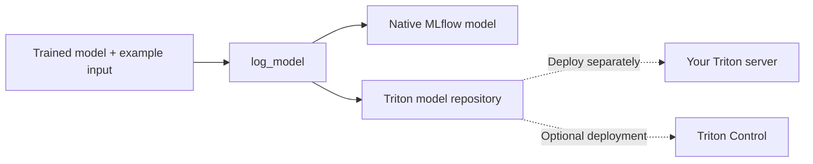

# MLflow → Triton

**Log trained models to MLflow with portable Triton serving files.**

[](https://github.com/ai-lab-tech/mlflow-plugin/actions/workflows/mlflow-plugin-ci.yml)
[](LICENSE)
[](packages/mlflow-triton/pyproject.toml)

[API reference](packages/mlflow-triton/README.md#log-api-reference) ·
[Quick starts](examples/README.md#quick-starts) ·
[Serving validation](examples/README.md#saved-model-serving-validation) ·
[Deployment integration](packages/mlflow-triton-control/README.md) ·
[Contributing](CONTRIBUTING.md)

Pass a trained scikit-learn, PyTorch or Hugging Face Transformers model and an
example prediction input. The library saves the MLflow model and generates
Triton configuration, serving code, model assets and an example request.

> Intended for demos and proofs of concept. Before production use, an ML engineer
> must review, validate and optimize the generated serving implementation.



## Choose your package

| Package | Purpose |
| --- | --- |
| [mlflow-triton](packages/mlflow-triton/README.md) | Log models and generate Triton serving files. No Triton Control dependency. |
| [mlflow-triton-control](packages/mlflow-triton-control/README.md) | Optional deployment through Triton Control; installs the matching core package. |

## Quick start

Requires Python 3.10+. Install your model's framework dependencies separately.

```bash
pip install mlflow-triton
```

With an already-fitted pipeline and a representative input DataFrame:

```python
from mlflow_triton import sklearn

info = sklearn.log_model(
    fitted_pipeline,
    name="classifier",
    input_example=example_dataframe,
)
print(info.model_uri)
```

The model and generated Triton files are now stored in MLflow at `info.model_uri`.
Configure your MLflow tracking URI and experiment before logging if needed.
`input_example` is required and its values are saved, so use non-sensitive inputs.

See the [Python API guide](packages/mlflow-triton/README.md) for PyTorch and
Transformers examples, arguments and optional file retrieval.
For a runnable example that creates its own small model, install `scikit-learn`
and run [`python examples/quickstart.py`](examples/quickstart.py) from this checkout.
Or run the [Google Colab notebook](https://colab.research.google.com/github/ai-lab-tech/mlflow-plugin/blob/main/examples/quickstart_colab.ipynb)
without a local installation; it includes an optional download of the serving files.
For installation from source, see [development setup](CONTRIBUTING.md#development-setup).

## Serving and validation

| Framework | Triton target |
| --- | --- |
| scikit-learn | CPU |
| PyTorch | CPU / GPU |
| Hugging Face Transformers | CPU / GPU |

Logging checks an example prediction and tensor mappings. It does not start Triton
or deploy a service. Install the recorded dependencies in a compatible Triton
Python backend environment and validate serving separately.

Use your deployment tooling or the optional
[Triton Control integration](packages/mlflow-triton-control/README.md).
See [validation and limitations](packages/mlflow-triton/README.md#validation-and-limitations)
for supported inputs and model requirements.

## Send an example request

First [retrieve the generated files](packages/mlflow-triton/README.md#retrieve-triton-files-optional)
and deploy the model using your tooling or the
[Triton Control integration](packages/mlflow-triton-control/README.md).
Once the model is ready in Triton, run the following from the retrieved model
directory. Replace the server address and `classifier` with your deployment's values:

```bash
curl --fail-with-body --show-error -X POST \
  http://localhost:8000/v2/models/classifier/infer \
  -H 'Content-Type: application/json' \
  --data-binary @request.json
```

For non-finite numbers or binary byte inputs, logging generates `request.bin` and
`request.headers` instead. Send these without editing the body or header length:

```bash
curl --fail-with-body --show-error -X POST \
  http://localhost:8000/v2/models/classifier/infer \
  -H @request.headers --data-binary @request.bin \
  --dump-header response.headers --output response.bin
```

The binary response is saved with its HTTP headers. Regenerate the example if the
model schema or example inputs change. Neither logging nor generating these files
sends requests automatically.

## Documentation

| Topic | Guide |
| --- | --- |
| Python API and examples | [Core package](packages/mlflow-triton/README.md) |
| Generated files and runtime details | [Advanced serving guide](packages/mlflow-triton/ADVANCED.md) |
| Optional deployment | [Triton Control integration](packages/mlflow-triton-control/README.md) |
| Test real Triton responses with Docker | [Example runner](examples/README.md) |
| Example weights and provenance | [Dataset setup](examples/data/README.md) |
| Local development and tests | [Contributing](CONTRIBUTING.md) |
| Versions and publishing | [Releasing](RELEASING.md) |
| Reporting vulnerabilities | [Security policy](SECURITY.md) |

## License and attribution

Original project code is licensed under [Apache-2.0](LICENSE). Included upstream
sources, model assets and dependencies retain their own terms; see
[third-party notices](THIRD_PARTY_NOTICES.md) and the documented outstanding
artifact-license review. Project names are used to identify integrations; this
project does not imply endorsement by MLflow, NVIDIA, PyTorch or Hugging Face.
