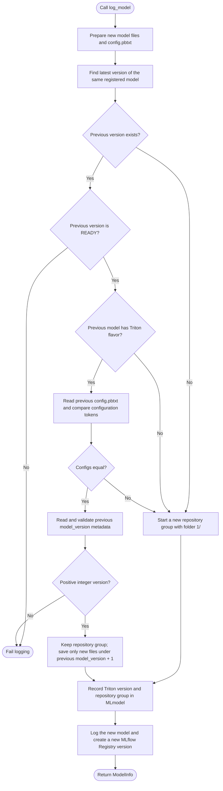

# Advanced serving guide

Details for inspecting, validating and deploying models logged with `mlflow-triton`.
For installation and Python arguments, see the [package README](README.md).

## Validation details

Before logging/registration, the wrapper executes the example prediction using
MLflow's prediction adapter around the supplied model, derives/checks the signature,
saves the native model and validates the input/output tensor mapping. It reuses
the existing weights. Unsupported schemas, invalid devices or failed predictions
raise an exception. A successful default return does not establish that the saved
artifact can be reloaded in another environment.

Use `validate_saved_model=True` to instead validate a CPU reload of the saved
artifact, including whether its custom code can be imported locally. The original
model remains in memory during this check. `validation.json` records the selected
mode and validation device; actual Triton serving and GPU execution must be
tested separately. There are no `deploy`, `validate_triton`, `max_batch_size` or
GPU-index arguments in these wrappers.

## Generated files and serving behavior

The logged artifact contains the native MLflow flavors and an additional `triton`
flavor pointing to:

```text
model_repository/<triton_model_name>/
  config.pbtxt
  requirements.txt
  request.json        # Or request.bin + request.headers for binary inputs
  validation.json
  1/
    model.py
    artifact/          # Complete local MLflow package, including code and assets
```

`mlflow.pyfunc.load_model(info.model_uri)` and MLflow framework loaders
remain usable for models logged with the framework wrappers. The embedded package is a separate copy so the Triton directory
can be deployed independently; this increases artifact storage size. Dependencies
are recorded, not installed into the running Triton server automatically. Build
an environment from `requirements.txt` with a Python version matching Triton's
Python backend stub; custom code dependencies must be included or installed.

The generated configuration uses `backend: "python"` and `max_batch_size: 0`.
Tensor shapes include their full batch dimension. Column schemas map to separate
rank-one tensors; tensor schemas retain their declared shapes. The `mlflow_contract` parameter in `config.pbtxt`
records mappings between original field names and Triton-safe tensor names.
Only dimensions marked as dynamic in the signature are retained; a single
example does not prove that other sequence/image dimensions are variable.
Supply an explicit signature when those dimensions need to be dynamic.

`device="cpu"` is the default. `device="gpu"` emits `KIND_GPU` for PyTorch or
Transformers; `model.py` uses the assigned Triton instance device when loading.
Default validation uses the supplied model's current device, independently of the
Triton target. Optional saved-artifact validation loads on CPU even for a GPU
target. Sharded/device-mapped models or tasks unsupported by MLflow pyfunc
need a separate adapter; the wrapper does not claim universal model support.

PyTorch uses Python/pickle packaging by default, **not** an implicit LibTorch/PT2
export. Supply required architecture modules with `code_paths` or dependencies.
Pre/postprocessing outside the supplied model/Pipeline is not captured. Transformers
packages preserve their saved tokenizer, chat template and model configuration,
and expose the MLflow task interface (which can differ from raw `forward()` or
pipeline outputs). Serving is unary prediction, not streaming or a dedicated
high-throughput LLM engine. No GGUF/Q4_K_M compatibility is implied.

Supported signatures contain NumPy-compatible numeric/string tensors or required
scalar DataFrame columns. Optional columns, nested/object schemas, datetime columns,
and scalar tensors require an explicit serving adapter and fail clearly rather than
being flattened or cast speculatively.

`validation.json` identifies in-memory or saved-artifact prediction validation,
records whether the saved artifact was checked, and distinguishes local mapping
validation from actual Triton validation. Logging does **not** launch Triton, deploy a service,
or establish GPU correctness.

## Model version updates

`registered_model_name` identifies the history used by all framework wrappers.
Logging compares against the latest Registry version of that name. A matching
config continues its Triton repository group; a changed config starts a new group
at `1/`. A first registration or a previous model without a Triton flavor also
starts at `1/`.

The following activity diagram shows a call with `registered_model_name`:



For a previous model with `model_version: 2`, the compatible path saves only
`3/` in the new artifact. It reads the previous metadata and `config.pbtxt`,
without listing, downloading, or copying previous model folders. Registry or
config access failures abort logging; deployment loads the new artifact separately.

Only `config.pbtxt` determines compatibility. Whitespace and protobuf comments
are ignored; configuration values and field order are compared. Weights,
backend code, and requirements are not compared. The `version` embedded inside
`mlflow_contract` describes the contract format and is compared like any other
value; it is not the numeric model directory version. Compatible updates keep
that config and save only the new numeric version directory. Triton's default
policy serves that version after the repository is loaded.

Every call still creates a new MLflow Registry version. Each artifact contains
only the newly logged Triton version; earlier artifacts are never modified.
For example, Registry versions 1 and 2 contain Triton directories `1/` and `2/`
respectively. Registry version 3 with a changed config starts a new group at `1/`.
Older models remain available through their original Registry versions and can
be deployed separately; the new artifact does not serve previous versions.
The Triton flavor in `MLmodel` records `model_version`, `repository_group`, and,
for compatible updates, `previous_model_uri`.

Without `registered_model_name`, logging starts at `1/` and does not look up
history. Access failures for existing metadata or config fail logging instead of
silently starting over. The latest Registry version must be `READY`; pending or
failed registration blocks the update. Matching configs require a positive
integer `model_version` in the previous Triton metadata. This also supports
previous artifacts containing multiple version folders without downloading them.
Calls for the same registered name must run sequentially to maintain a linear
version sequence; concurrent calls can choose the same next number.

## Disk space and concurrent loading

Logging creates two copies of the model: the MLflow model and a self-contained
copy for Triton serving. Updates read only the previous metadata and config;
they do not create additional copies of earlier versions. Existing Registry
artifacts are retained. Allow disk space for the new model's two copies and
MLflow's temporary files. Set `TMPDIR` before logging to choose a temporary
directory on a disk with enough space. Incomplete staging files are cleaned up if packaging fails.

The serving runtime temporarily changes MLflow device and offline environment
settings while loading a model, then restores them. It serializes its own model
loads, but cannot coordinate with unrelated code that changes `os.environ` or
loads models directly through MLflow. Use separate processes for those operations
if they could run concurrently. Prediction requests are not serialized by this lock.

## MLflow mapping in Triton configuration

Generated repositories store the MLflow-specific mapping as JSON in the
`parameters.mlflow_contract.string_value` field of `config.pbtxt`. It contains a
mapping version, framework flavor, input/output structure (columns, single tensor
or named tensors), original field names and text/binary semantics. Tensor names
link mapping entries to the standard `input` and `output` configuration fields;
datatypes and shapes are read exclusively from those fields.

Triton passes the configuration to `model.py.initialize()` as `args["model_config"]`.
The runtime validates and reconstructs its tensor mapping from it. Device placement
still comes from Triton's assigned instance kind/device ID. No separate
`contract.json` is generated or read by the new runtime. Unsupported mapping
versions, missing tensor mappings and nonzero `max_batch_size` fail initialization.

Existing logged artifacts retain their original `model.py` and `contract.json`.
Re-log a model to produce the new layout; do not mix old generated runtime files
with new configuration. Editing a mapping or tensor schema must remain compatible
with the saved model's prediction interface and requires renewed validation.

## Ready-to-send inference example

Each framework wrapper generates one `request.json` beside `config.pbtxt`, using
values from `input_example`, concrete tensor shapes and all configured output names.
See the [central request instructions](https://github.com/ai-lab-tech/mlflow-plugin#send-an-example-request)
for curl commands. No per-model shell script or instruction file is generated.
Logging does not send a request.

For NaN/infinity or binary byte inputs, the example instead consists of
`request.bin` (complete HTTP body, including its JSON prefix) and `request.headers`
(the HTTP content type and JSON-prefix byte length). This uses
[Triton's binary tensor extension](https://docs.nvidia.com/deeplearning/triton-inference-server/user-guide/docs/protocol/extension_binary_data.html)
without changing input values. Outputs are requested as binary in that case.

Example files contain the supplied input values, just like MLflow's stored input
example; use non-sensitive examples.

## Inspect model architecture without loading weights

PyTorch and Transformers wrappers automatically include `architecture.json` in the
MLflow artifact and its self-contained Triton `<version>/artifact/` copy. Read this JSON
without importing custom model code or loading weights. It records the model class,
module classes, parameter/buffer shapes and dtypes (never tensor values), and relative
paths to packaged Python and configuration files. Transformers reports component
classes such as the tokenizer; its saved `config.json` contains model configuration.

| Argument | Required | Meaning |
| --- | --- | --- |
| `architecture_init_kwargs` | No | JSON object documenting constructor arguments, supplied by the caller. Defaults to unknown; never guessed or passed to the constructor. |

```python
from mlflow_triton import pytorch

pytorch.log_model(
    model,
    input_example=example,
    code_paths=["custom_network.py"],
    architecture_init_kwargs={"input_size": 16, "hidden_size": 32},
)
```

The same optional argument is supported by `mlflow_triton.transformers.log_model`.
Include only non-sensitive architecture settings, never credentials or training data.
This is documentation, not an automatic reconstruction recipe: module structure
cannot describe arbitrary `forward()` logic or preprocessing. Constructor settings
are caller-declared and are not verified against the model. Required custom code
must still be included using `code_paths` or installed dependencies. Existing artifacts
are unchanged; the report is generated on subsequent logging. Serving inputs,
outputs, weights and `config.pbtxt` are unaffected.
