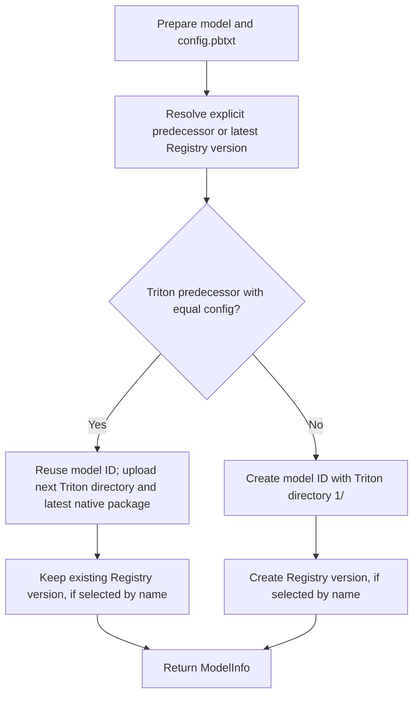

# Advanced serving guide

Details for inspecting, validating and deploying models logged with `mlflow-triton`.
For installation and Python arguments, see the [package README](README.md).

## Validation details

Before logging/registration, the wrapper executes the example prediction using
MLflow's prediction adapter around the supplied model, derives/checks the signature,
saves the native model and validates the input/output tensor mapping. It reuses
the existing weights. Unsupported schemas, invalid devices or failed predictions
raise an exception. A successful default return does not establish that the saved
artifact can be reloaded in another environment.

Use `validate_saved_model=True` to instead validate a CPU reload of the saved
artifact, including whether its custom code can be imported locally. The original
model remains in memory during this check. `validation.json` records the selected
mode and validation device; actual Triton serving and GPU execution must be
tested separately. There are no `deploy`, `validate_triton`, `max_batch_size` or
GPU-index arguments in these wrappers.

## Generated files and serving behavior

The logged artifact contains the native MLflow flavors and an additional `triton`
flavor pointing to:

```text
model_repository/<triton_model_name>/
  config.pbtxt
  request.json        # Or request.bin + request.headers for binary inputs
  validation.json
  1/
    requirements.txt
    model.py
    artifact/          # Complete local MLflow package, including code and assets
```

`mlflow.pyfunc.load_model(info.model_uri)` and MLflow framework loaders
remain usable for models logged with the framework wrappers. The embedded package is a separate copy so the Triton directory
can be deployed independently; this increases artifact storage size. Dependencies
are recorded, not installed into the running Triton server automatically. Build
an environment from `<version>/requirements.txt` with a Python version matching
Triton's Python backend stub; custom code dependencies must be included or installed.

The generated configuration uses `backend: "python"` and `max_batch_size: 0`.
Tensor shapes include their full batch dimension. Column schemas map to separate
rank-one tensors; tensor schemas retain their declared shapes. The `mlflow_contract` parameter in `config.pbtxt`
records mappings between original field names and Triton-safe tensor names.
Only dimensions marked as dynamic in the signature are retained; a single
example does not prove that other sequence/image dimensions are variable.
Supply an explicit signature when those dimensions need to be dynamic.

`device="cpu"` is the default. `device="gpu"` emits `KIND_GPU` for PyTorch or
Transformers; `model.py` uses the assigned Triton instance device when loading.
Default validation uses the supplied model's current device, independently of the
Triton target. Optional saved-artifact validation loads on CPU even for a GPU
target. Sharded/device-mapped models or tasks unsupported by MLflow pyfunc
need a separate adapter; the wrapper does not claim universal model support.

PyTorch uses Python/pickle packaging by default, **not** an implicit LibTorch/PT2
export. Supply required architecture modules with `code_paths` or dependencies.
Pre/postprocessing outside the supplied model/Pipeline is not captured. Transformers
packages preserve their saved tokenizer, chat template and model configuration,
and expose the MLflow task interface (which can differ from raw `forward()` or
pipeline outputs). Serving is unary prediction, not streaming or a dedicated
high-throughput LLM engine. No GGUF/Q4_K_M compatibility is implied.

Supported signatures contain NumPy-compatible numeric/string tensors or required
scalar DataFrame columns. Optional columns, nested/object schemas, datetime columns,
and scalar tensors require an explicit serving adapter and fail clearly rather than
being flattened or cast speculatively.

`validation.json` identifies in-memory or saved-artifact prediction validation,
records whether the saved artifact was checked, and distinguishes local mapping
validation from actual Triton validation. Logging does **not** launch Triton, deploy a service,
or establish GPU correctness.

## Model version updates

`model_uri` selects an explicit predecessor in all framework wrappers
(`models:/<model_id>`, a Registry version/alias, or `runs:/<run_id>/<path>`).
Run and Registry references must resolve to a package with an MLflow 3 logged-model
ID to permit compatible updates. Missing identity fails clearly rather than
silently creating another model. Explicit references are resolved once before
metadata and config access. Alternatively, `registered_model_name` selects the
latest Registry version of that name. The parameters are mutually exclusive;
supplying both raises `ValueError` before preparation or logging.

Both selection methods follow the same rules:

| Predecessor | Logged model | Triton directory | Registry when selected by name |
| --- | --- | --- | --- |
| Matching config | Reuse existing ID | Append next number; retain earlier versions | Reuse current Registry version |
| Different config | Create new ID | Start at `1/` | Create next Registry version |
| None, or no Triton flavor | Create new ID | Start at `1/` | Create first/next Registry version |



For example, two compatible calls with `registered_model_name="classifier"`
keep Registry version 1 and the same logged-model ID. Its repository now contains
both `1/` and `2/`. A third call with a changed config creates Registry version 2
with a different model ID and a repository starting at `1/`.
`info.registered_model_version` returns the reused or newly created Registry
version for name-based logging. Explicit URI updates do not register anything.

MLflow's `MlflowClient.log_model_artifacts` uploads the new files into the existing
artifact location. Run/model output links are added only if not already present. Earlier numeric directories are left untouched, including their
weights, backend code, native packages, and `<version>/requirements.txt`.
The native package at the artifact root, request example, validation report,
and `MLmodel` metadata are replaced by the latest model. Consequently the same
`models:/<model_id>` and Registry URI now load the **latest** native weights.
To load an older native package, use its `<version>/artifact/` directory.
No old model weights are downloaded or copied during updates.

Only `config.pbtxt` determines compatibility. Whitespace and protobuf comments
are ignored; configuration values and field order are compared. Weights,
backend code, and requirements are not compared. The `version` embedded inside
`mlflow_contract` describes the contract format, not the Triton directory number.
A requirements-only change therefore appends a version; deployment must provide
its matching environment. Triton's default version policy loads the latest
numeric directory when the repository is loaded. Logging does not reload an
already running Triton server.

The Triton flavor records `model_version`, `repository_group`, and, for compatible
updates, `model_uri`. Missing `model_version` defaults to `1` for legacy
packages; an explicit value must be a positive integer. Access failures abort
logging. The latest Registry version must be `READY` when selecting by name.
Without either history parameter, logging creates a new model at `1/`.

Updates retain the logged model's original name, experiment, source run, model
parameters, and tags. MLflow associates an active/supplied update run with the
same model as an output; the artifact's metadata and native package describe
the latest update. `name`, `params`, and `tags` passed to logging apply when a
new logged model is created.

Calls updating the same model or registered name must run sequentially; there
is no distributed lock. Artifact uploads are not transactional: a failed upload
can leave partial files and MLflow may mark the model failed. Earlier numeric
version directories are not overwritten by the update.

## Disk space and concurrent loading

Logging creates two copies of the model: the MLflow model and a self-contained
copy for Triton serving. Updates read only the previous metadata and config;
they do not create additional copies of earlier versions. Existing Triton
version directories are retained. Allow disk space for the new model's two copies and
MLflow's temporary files. Set `TMPDIR` before logging to choose a temporary
directory on a disk with enough space. Incomplete staging files are cleaned up if packaging fails.

The serving runtime temporarily changes MLflow device and offline environment
settings while loading a model, then restores them. It serializes its own model
loads, but cannot coordinate with unrelated code that changes `os.environ` or
loads models directly through MLflow. Use separate processes for those operations
if they could run concurrently. Prediction requests are not serialized by this lock.

## MLflow mapping in Triton configuration

Generated repositories store the MLflow-specific mapping as JSON in the
`parameters.mlflow_contract.string_value` field of `config.pbtxt`. It contains a
mapping version, framework flavor, input/output structure (columns, single tensor
or named tensors), original field names and text/binary semantics. Tensor names
link mapping entries to the standard `input` and `output` configuration fields;
datatypes and shapes are read exclusively from those fields.

Triton passes the configuration to `model.py.initialize()` as `args["model_config"]`.
The runtime validates and reconstructs its tensor mapping from it. Device placement
still comes from Triton's assigned instance kind/device ID. No separate
`contract.json` is generated or read by the new runtime. Unsupported mapping
versions, missing tensor mappings and nonzero `max_batch_size` fail initialization.

Existing logged artifacts retain their original `model.py` and `contract.json`.
Re-log a model to produce the new layout; do not mix old generated runtime files
with new configuration. Editing a mapping or tensor schema must remain compatible
with the saved model's prediction interface and requires renewed validation.

## Ready-to-send inference example

Each framework wrapper generates one `request.json` beside `config.pbtxt`, using
values from `input_example`, concrete tensor shapes and all configured output names.
See the [central request instructions](https://github.com/ai-lab-tech/mlflow-plugin#send-an-example-request)
for curl commands. No per-model shell script or instruction file is generated.
Logging does not send a request.

For NaN/infinity or binary byte inputs, the example instead consists of
`request.bin` (complete HTTP body, including its JSON prefix) and `request.headers`
(the HTTP content type and JSON-prefix byte length). This uses
[Triton's binary tensor extension](https://docs.nvidia.com/deeplearning/triton-inference-server/user-guide/docs/protocol/extension_binary_data.html)
without changing input values. Outputs are requested as binary in that case.

Example files contain the supplied input values, just like MLflow's stored input
example; use non-sensitive examples.

## Inspect model architecture without loading weights

PyTorch and Transformers wrappers automatically include `architecture.json` in the
MLflow artifact and its self-contained Triton `<version>/artifact/` copy. Read this JSON
without importing custom model code or loading weights. It records the model class,
module classes, parameter/buffer shapes and dtypes (never tensor values), and relative
paths to packaged Python and configuration files. Transformers reports component
classes such as the tokenizer; its saved `config.json` contains model configuration.

| Argument | Required | Meaning |
| --- | --- | --- |
| `architecture_init_kwargs` | No | JSON object documenting constructor arguments, supplied by the caller. Defaults to unknown; never guessed or passed to the constructor. |

```python
from mlflow_triton import pytorch

pytorch.log_model(
    model,
    input_example=example,
    code_paths=["custom_network.py"],
    architecture_init_kwargs={"input_size": 16, "hidden_size": 32},
)
```

The same optional argument is supported by `mlflow_triton.transformers.log_model`.
Include only non-sensitive architecture settings, never credentials or training data.
This is documentation, not an automatic reconstruction recipe: module structure
cannot describe arbitrary `forward()` logic or preprocessing. Constructor settings
are caller-declared and are not verified against the model. Required custom code
must still be included using `code_paths` or installed dependencies. Existing artifacts
are unchanged; the report is generated on subsequent logging. Serving inputs,
outputs, weights and `config.pbtxt` are unaffected.
